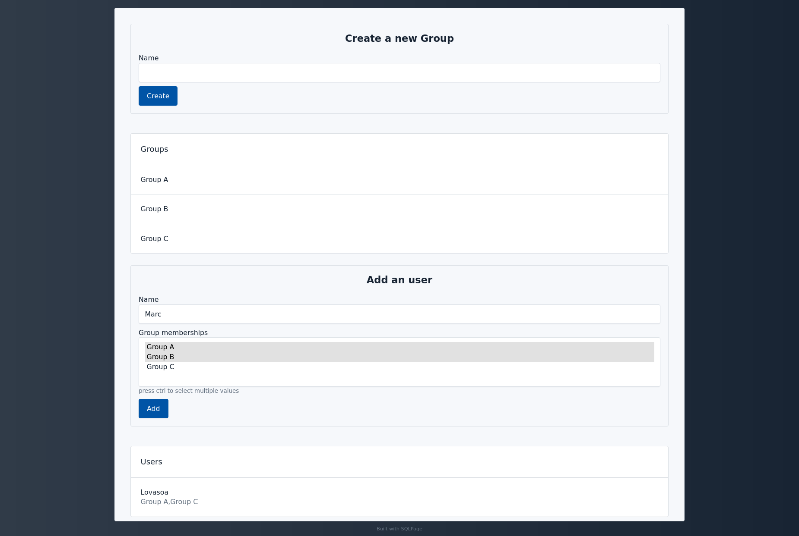

# Onboard users and assign groups with SQL Server

Create groups, then use a SQLPage form to onboard users and assign their
memberships. SQL Server saves the user and memberships together.



## Try it

Run `docker compose up` in this directory and open the [onboarding page](http://localhost:8080/).
The database container runs `sqlcmd` to create the tables.

1. Create two groups. Use **View group** in the confirmation to jump to the new group. A blank description is saved as SQL `NULL`.
2. Under **Add a user**, enter a name and select both groups. You can also add a user with no groups.
3. Submit the form and check the memberships under **Users**.

## How it works

- `OUTPUT INSERTED` gives SQLPage the new group and its generated ID for the confirmation link. `FOR JSON PATH` supplies the groups to the multi-select.
- SQLPage binds the submitted name and group choices into the `IF ... BEGIN ... END` batch in `index.sql`. `SCOPE_IDENTITY()` returns the new user ID, and `OPENJSON ... WITH` reads the selected IDs as integers.
- The batch saves the user and memberships in one transaction. If a selected group has been deleted since the form loaded, the foreign key rejects the selection and `XACT_ABORT` rolls back the entire transaction.
- `CROSS APPLY` and `STRING_AGG` summarize memberships for each user. Users without memberships stay visible.

Run the end-to-end test from the repository root.

```sh
scripts/test-examples-hurl.sh 'examples/microsoft sql server advanced forms'
```
